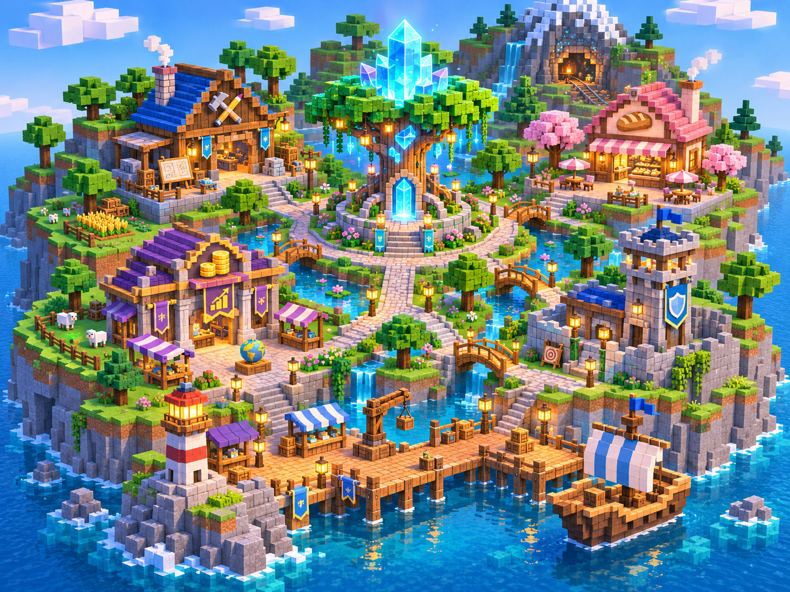

# Treasureport · Crystal Harbour

An **original 3D voxel-style financial-literacy adventure prototype**, inspired by the idea of a walkable hub with four educational challenges. It does not copy Minar's original source code, artwork, storyline, or game engines.



## Features

- **Actual 3D geometry:** custom dependency-free WebGL renderer for the block-world island, architecture, trees, harbour, crystal tree, gate, and animated voxel explorer (not a flat map image).
- **Character select:** choose Explorer Finn or Explorer Mira, with a different moving 3D avatar, plus a customizable explorer name.
- **Free-roam controls:** WASD / arrow keys, touch directional pad, click-to-walk with A* pathfinding, drag to orbit the camera, scroll or +/- to zoom, press E near a door to enter.
- **Four interactive guild activities:** Builder's Workshop (planning), Harbour Bakery (saving), Merchant Guild (investment judgement), Guardian's Watch (scam safety).
- **Progression:** each completed activity illuminates a crystal. Complete all four to unlock the Crystal Gate.
- **Feedback:** judgement scores, wellbeing, financial-goal meter, replay, and a break action.
- **Privacy:** no sign-in, no backend, and no analytics. Saves locally in your browser's `localStorage`.
- **Responsive:** desktop and phone layouts. A WebGL-capable browser is recommended for real 3D; an illustrated 2D fallback keeps the quests playable if WebGL is unavailable.

> **Scope:** This is an independent playable UI + original mini-scenario prototype. The four original Minar game engines are **not** included and their detailed mechanics are **not** fully reproduced. For any existing games you own, integrate their game modules behind the four `openGuild()` entry points in `app.js` while keeping the original gameplay rules in those modules.

## Run locally

No `npm install` or build step is needed. On macOS, Linux, or Windows (with Python installed):

```bash
cd treasureport-project
python3 -m http.server 5173
```

Open [http://localhost:5173](http://localhost:5173) in your browser. You can also open `index.html` directly, although an HTTP server is recommended.

## Controls

| Input | Action |
| --- | --- |
| WASD or arrow keys | Move the explorer |
| Click/tap ground | Walk to that location using A* pathfinding |
| Click a guild building or the guild panel | Walk to its doorway and enter |
| E (near a guild doorway) | Enter the activity |
| Drag on the world | Orbit the 3D view |
| Mouse wheel / plus-minus buttons | Zoom |
| Left and right rotation buttons | Rotate the camera |
| Mobile directional pad | Move on touch devices |
| Esc | Exit a game activity |

## Files

- `index.html` – application structure, character selection and in-game UI
- `styles.css` – responsive visual theme and overlays
- `app.js` – voxel renderer, animation, movement, A* navigation, game activities and persistence
- `assets/concept-map.png` – original concept image used on the onboarding screen and the non-WebGL fallback (visual inspiration, not the WebGL rendered map)
- `push-to-github.sh` – one-time upload helper for the specified empty GitHub repository

## Deploy to GitHub Pages

Since the repository is initially empty, you can run `bash push-to-github.sh` from this folder (requires GitHub authentication) to upload the files, then choose **Settings → Pages → Deploy from a branch → main / (root)**. GitHub Pages should then serve `index.html` as a static website.

## Roadmap

1. Improve voxel mesh detail, terrain variation, and animated water to move closer to the concept art.
2. Add mobile pinch-to-zoom and responsive camera framing improvements.
3. Add NPC conversations, audio optionally, and a quest journal.
4. Plug in the production learning-game engines behind the guild entrances.
5. Add performance modes and automated browser interaction tests.

## Attribution

This prototype uses independent code, simple procedural geometry, and an original generated concept image. It follows the general educational **four-challenge hub** concept discussed in the design brief. It is not a fork of `chandranisaha/minar` and does not include code or other assets from that project.
